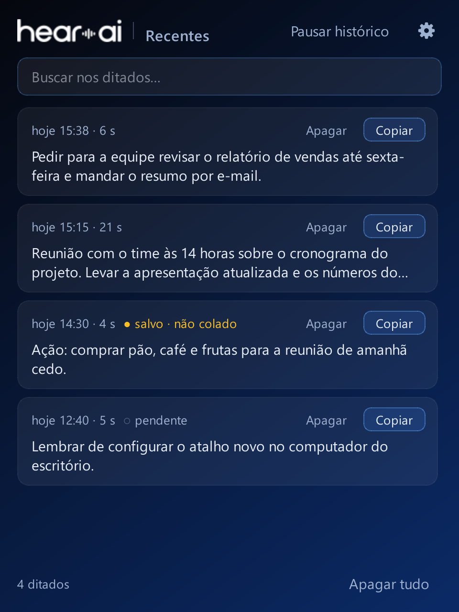

# Hear AI — local voice dictation for Windows



Hold **Ctrl+Alt+H**, speak, and release: the text appears wherever your cursor is. Transcription runs on your own PC (local [faster-whisper](https://github.com/SYSTRAN/faster-whisper)), with no internet connection and no telemetry.

> **Note on language:** the app's interface (windows, buttons, tray menu, messages) is in **Brazilian Portuguese**. This documentation is in English and quotes the on-screen labels in Portuguese, followed by an English gloss in parentheses where it helps. Windows 10/11 only; developed and tested on Windows 11.

## What it does

- **Global dictation:** a hotkey works in any program; the text is pasted into the active window (and the original clipboard is restored, if it was text).
- **Floating bubble** near the taskbar shows the state (recording, processing, pasted) and a **waveform that follows your voice**. **One click** on the bubble starts/stops recording; **two quick clicks** discard what you just started and open the *Recentes* (Recents) window; dragging moves it.
- **Long dictations:** the recording is transcribed in chunks while you speak (default limit: 30 minutes, with a warning 1 minute before).
- **Recentes (Recents):** a local history (only on your PC; 30 days by default; can be turned off or paused), with search, copy and delete.
- **Vocabulary:** the default dictionary fixes names and terms (see below) without replacing common words. In *Recentes* you choose *Lembrar* (Remember) or *Corrigir…* (Correct…) to teach a correction — **nothing is learned without your click**.
- **Models:** `small` (default, ~480 MB) or `medium` (~1.5 GB, downloaded only if you click *Baixar agora* / Download now).
- **Two operating modes:**
  - **Mode A — faithful transcription (default):** speech → local Whisper → text. No network.
  - **Mode B — prompt generator:** the faithful transcript is rewritten as a structured prompt by a language model. It uses [Ollama](https://ollama.com) **installed by you** (`127.0.0.1` only). There is also an option to use a cloud endpoint compatible with the OpenAI API; it only works after you accept, in the Settings window, sending the **text** of your speech (never the audio) to one specific address. The key lives in an environment variable, never in the configuration file. If the generator fails or is not installed, **the faithful transcript is pasted** and the history keeps your original speech. Switch modes: tray menu or `Ctrl+Alt+M`.

| Tray icon | Meaning |
|---|---|
| gray | loading the model |
| normal | ready |
| red dot | recording |
| yellow dot | transcribing |
| blue dot | text saved (not pasted: use Ctrl+V) |
| black dot | error (model failed to load, hotkey conflict…) |

## Requirements

- Windows 10 or 11 (64-bit).
- **Python 3.14** (see *How to install Python* below), reachable through the `py` or `python` command (`instalar.bat` tries both). **The required version is 3.14** (`pyproject.toml` asks for `>= 3.14`); other versions have not been tested.
- A microphone.
- About 1 GB of free disk space for the Python environment and the `small` model (`medium` needs ~1.7 GB more; see [`docs/MODELOS.md`](docs/MODELOS.md)).
- Optional: an NVIDIA graphics card (acceleration), Ollama (Mode B).

### How to install Python

The required version is **3.14**; other versions have **not been tested**.

1. Download the Python 3.14 installer from <https://www.python.org/downloads/> (Windows, 64-bit).
2. On the first screen of the installer, **check "Add python.exe to PATH"** and click *Install Now*.
3. To verify, open a new terminal (PowerShell) and run `py --version` (or `python --version`): it should print `Python 3.14.x`.

Alternative from the terminal (the ID `Python.Python.3.14` exists in `winget`):

```powershell
winget install Python.Python.3.14
```

Then close and reopen the terminal so the `py`/`python` command is recognized.

## Installation

1. Download/clone this repository.
2. Double-click **`instalar.bat`**: it creates the `.venv` environment, installs `requirements.txt` and downloads the `small` model. This is the only step that uses the internet.
3. Double-click **`iniciar.bat`**. An icon appears in the system tray (near the clock); wait until it leaves the gray state.
4. Click in a text field, **hold Ctrl+Alt+H**, speak and **release**. To quit: right-click the icon → **Sair** (Quit).

> `instalar.bat` and installation from a clean machine **have not been tested outside the author's machine**.

## Usage

- **Hotkey** (`Ctrl+Alt+H`) and **mode** *segurar* (hold, the default) or *alternar* (toggle: one press starts, another ends): Settings (the gear in *Recentes*, or tray menu → *Abrir configurações* / Open settings).
- **Esc** during recording cancels and discards it.
- Programs running **as administrator** do not accept automatic pasting from a regular app: the text stays on the clipboard and in the history (use Ctrl+V).
- The configuration is stored in `config.json` (created on first run, in the program folder). The default dictionary (`"dictionary"` in that file) contains *Ondex*, *Maestri*, *Groq*, *Hear AI* and *Claude Code* — these are the author's names and **you can edit or empty the list**.

### GPU acceleration (optional)

With an NVIDIA card: `.venv\Scripts\python.exe -m pip install -r requirements-gpu.txt` (~915 MB; these are **optional, proprietary NVIDIA packages** — read their terms of use before installing or redistributing) and, in Settings, choose *Processar no: automático* (Process on: automatic). If the GPU fails, the app falls back to the CPU by itself. Details and measurements in [`docs/GPU.md`](docs/GPU.md).

### Mode B with Ollama (optional)

Mode B rewrites what you said as a structured prompt, using a language model that runs on your PC through [Ollama](https://ollama.com). Without Ollama, Hear AI keeps working: Mode B simply pastes the faithful transcript.

1. **Install Ollama.** Download the installer from <https://ollama.com/download> (`OllamaSetup.exe`) or, in the terminal: `winget install Ollama.Ollama`.
2. **Close the terminal and open a new one**, so the `ollama` command is recognized.
3. **Download a model:**
   ```powershell
   ollama pull qwen3:8b
   ```
   That is a ~5.2 GB download (size listed in the official Ollama catalog). If your PC is modest (little memory), use the smaller one: `ollama pull qwen3:4b` (~2.5 GB).
4. **Check with `ollama list`:** the downloaded model should appear in the list.
5. **Keep the Ollama app open** (its icon sits near the clock); Hear AI talks to it on `127.0.0.1`, on your computer only.
6. **In Hear AI:** *Configurações → Modo de operação → Gerador de prompts → Verificar de novo* (Settings → Operating mode → Prompt generator → Check again), pick the model from the list and click **Salvar** (Save).
7. **Switch between modes** with `Ctrl+Alt+M` (or from the tray menu).

> When you open the Ollama app, a list of programming tools to install may appear. It is **not needed** for Hear AI.

If Ollama is not installed or not running, the window shows "indisponível: gerador local não encontrado" (unavailable: local generator not found) and the pasted text is the faithful transcript. The system prompt is the file [`prompts/gerador-de-prompts.md`](prompts/gerador-de-prompts.md) (kept in Portuguese, because it drives the Portuguese-language behavior of the generator) and can be edited. More in [`docs/MODOS.md`](docs/MODOS.md).

## Privacy

- No telemetry. Transcription and dictation work without a network (a test blocks sockets to prove the main path: `scripts/prova_offline.py`).
- The internet is only used when **you** start it: `instalar.bat` (pip and model), the *Baixar agora* button for `medium`, and — only if you accept — the cloud endpoint of Mode B.
- Logs (`logs\`) record states and timings, **never the dictated text**. The history (`historico\`) keeps the text on your PC and can be turned off in Settings.
- If the Windows clipboard history (**Win+V**) is on, each dictation is also recorded there (Windows behavior).

## Limitations and what has NOT been tested

Verified by automated tests (more than 1,100) and, in part, by screenshots generated off-screen. **Not** verified:

- A from-scratch installation with `instalar.bat` on another machine; other Python versions.
- The bubble's waveform with a variety of real microphones (the tests use synthetic signals); bubble clicks and focus on real screens with different DPI/monitors.
- Whether the bubble sometimes disappears on real Windows: there is a watchdog and a diagnostic log (`logs\bolha-diag.log`), but the cause was not proven. Exclusive full-screen windows may cover the bubble. See [`docs/BOLHA-SOME.md`](docs/BOLHA-SOME.md).
- Downloading and using the `medium` model (never downloaded during the tests); GPU acceleration on other cards (tested only on an RTX 5060).
- **Mode B quality:** no real language model was used in the tests (only simulated providers). There are 18 evaluation cases in `tests/gerador/casos.jsonl` and the script `scripts/avaliar_gerador.py` for you to measure with your own model.
- Only text is restored to the clipboard (an image copied beforehand is lost).

## Running the tests

```
.venv\Scripts\python.exe -m pytest -q
```

Some tests are skipped without the `small` model in `models\` or in other environments; the interface tests use Qt in *offscreen* mode. There are also tests that use real Windows (an off-screen test window, no real keystrokes). Some tests need the audio files in `tests/fixtures/`, so those are kept in the repository.

## How it was made

The project was built with a team of AI agents coordinated by one person: see [`docs/COMO-FOI-FEITO.md`](docs/COMO-FOI-FEITO.md).

## License and brand

- **Code:** [MIT](LICENSE).
- **Brand:** the Ondex isotype and the Hear AI logotype (`assets/`) are **not** under the MIT license — see [`assets/LEIA-ME-MARCA.md`](assets/LEIA-ME-MARCA.md).
- **Direct dependencies** (summary, not exhaustive; full licenses are in each package — according to the installed packages): faster-whisper (MIT), sounddevice (MIT), numpy (BSD-3-Clause and other permissive ones), Pillow (MIT-CMU), keyboard (MIT), pyperclip (BSD), pytest (MIT), **PySide6-Essentials (LGPL-3.0 or GPL)** and, optional for the GPU, `nvidia-cublas-cu12` and `nvidia-cuda-nvrtc-cu12` (NVIDIA proprietary license, distributed by NVIDIA via pip; not part of this repository).
- **Qt / PySide6 (LGPL):** this repository only publishes the source code. If you distribute a **packaged** version (for example an `.exe`) or a modified version of Qt/PySide6, comply with the LGPL/GPL obligations; publishing the code here does not fulfil them by itself.
- **Whisper models:** the original weights are from OpenAI Whisper (MIT), but the app downloads the faster-whisper conversion from the `Systran/faster-whisper-*` repositories on Hugging Face, to your machine (none of that is in this repository). Check the license and terms on the page of the model you download.
- **Test audio files:** the `.wav` files in `tests/fixtures/` (a few hundred KB; about 790 KB in total) were generated with Windows speech-synthesis voices (System.Speech), only to test transcription. If you intend to redistribute them in other ways, check the terms of use of those voices; `scripts/gerar_fixture.ps1` recreates them.
